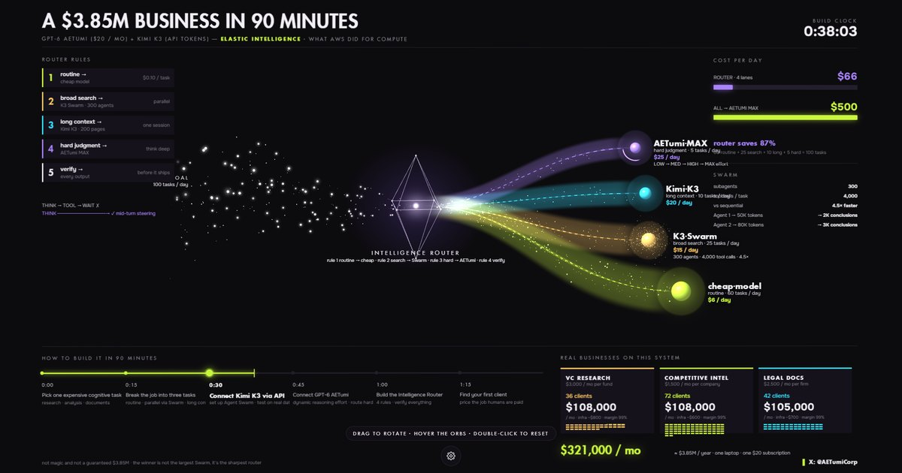

# Intelligence Router — an interactive Three.js scene

A live, rotatable Three.js visualisation of an AI **intelligence router**: one goal of 100 tasks a day streams in as particles, passes through a wireframe octahedron and splits into four model lanes, while an HTML dashboard counts cost ($500 → $66 a day) and revenue in real time.

**Live demo:** https://aetumi.app/threejs/intelligence-router/



Free to learn from, fork and reuse.

## Try it

- **Drag** to rotate the scene in 3D — it keeps a little momentum.
- **Hover** an orb, a rule card or the router: that lane lights up and the others step back. **Click** an orb to pin its lane.
- Particles move out of the cursor's way. **Double-click** returns to the front view.
- **⚙ Scene controls:** eight themes (AETumi Luxe, Sakura Pastel, Kintsugi Gold, Midnight, Cyber Neon, Aurora, Ocean Deep, Monochrome), per-lane colour pickers, motion speed, particle density, glow, 3D depth, zoom, auto-orbit, dashboard tilt and render quality. Settings persist in `localStorage`.

## Run it locally

Static files, no build step, no external requests.

```bash
cd examples/intelligence-router
python -m http.server 8080
```

Open http://localhost:8080.

| URL parameter | Effect |
|---|---|
| `?t=20` | Freeze the scene at second 20 (useful for visual regression and screenshots) |
| `?theme=sakura` | Start in a given theme: `luxe`, `sakura`, `kintsugi`, `midnight`, `neon`, `aurora`, `ocean`, `mono` |
| `?quay=1` | Frame-exact recording mode: exposes `window.__veTai(t, dt)` to render one frame at time `t` (used to make `assets/preview.mp4`) |

`prefers-reduced-motion` freezes the scene automatically.

## How it works

Everything lives in [`assets/app.js`](assets/app.js) (~700 lines, plain ES modules, Three.js r143).

**1. A perspective camera that is pixel-exact on the front view.** The scene is authored in pixels of a 1920×1080 stage. The camera sits at `D = (H/2) / tan(fov/2)`, so the z = 0 plane maps 1:1 onto the stage. Every point with depth is placed with a compensation helper so that it still lands on its exact pixel when viewed head-on:

```js
const w3 = (sx, sy, z, o) => {           // stage pixel (sx, sy) at depth z → world
  const k = (D - z) / D;
  o.x = (sx - W / 2) * k; o.y = (H / 2 - sy) * k; o.z = z;
  return o;
};
```

The front view therefore looks exactly like a flat 2D dashboard, and the depth only appears when you rotate. The whole scene hangs from a pivot group at the router, so rotation swings the fan of lanes around it.

**2. Lanes as crossed ribbons.** Each lane is a cubic Bézier, sampled 110 times. Two ribbon strips are built along it — one facing the camera, one perpendicular — so the lane still reads as a glowing volume from the side. A fragment shader draws the soft body and a dashed centre line whose dashes flow toward the model (`fract(u * length / 15 - time)`).

**3. Billboards for glows and orbs.** Router glows and the model orbs are quads that always face the camera (the vertex shader offsets `modelViewMatrix * vec4(0,0,0,1)` in view space). The orbs are shaded spheres drawn in the fragment shader, with a halo disc, a hover ring and — on the top lane — a rotating arc.

**4. Particles that avoid the cursor.** About a thousand points move each frame: the incoming stream, per-lane traffic and the swirl around the swarm. Each particle is projected to screen space with the combined `projection × view × model` matrix, pushed away from the pointer inside a 120 px radius, and eased back with a soft spring. Point size is scaled by depth so near particles grow when the scene turns.

**5. Motion fitted from a reference.** The lane endpoints drift on a 48-second loop described by a 3-harmonic Fourier series, fitted to the motion of the reference animation over 95 sampled frames (mean error 3–8 px). It loops seamlessly.

**6. Real HTML for all text.** The dashboard is HTML laid over the canvas: sharp at any size, selectable, readable by search engines and screen readers. Labels that belong to 3D objects are re-projected every frame; the dashboard itself tilts slightly with the scene via CSS 3D transforms, clamped so it stays readable.

## Make it yours

- **Colours and themes:** edit the `THEMES` object at the top of `app.js`. Each theme sets the background, panel colours, two accents and four lane colours; the dashboard follows through CSS variables (`--l0…--l3`, `--cam`, `--luc`).
- **Lanes:** the `LAN` array sets each lane's width, orb size, particle count and depth.
- **Numbers:** the dashboard figures live in `index.html` and in the `DN` / `BUOC` arrays in `app.js`.

## Credits and licences

- Code: MIT, © AETumi Corp — see the repository [`LICENSE`](../../LICENSE).
- Three.js r143: MIT.
- Onest typeface: SIL Open Font License 1.1 — see [`assets/fonts/OFL.txt`](assets/fonts/OFL.txt).
- The live site also uses AETumi's licensed Futura; it is **not** included here, and the page falls back to Onest.
- Visual concept inspired by [@0xkkai](https://x.com/0xkkai).
- The business figures are an illustrative scenario, not a promise of income.

Built by [AETumi](https://aetumi.app) · [@AETumiCorp](https://x.com/AETumiCorp)
